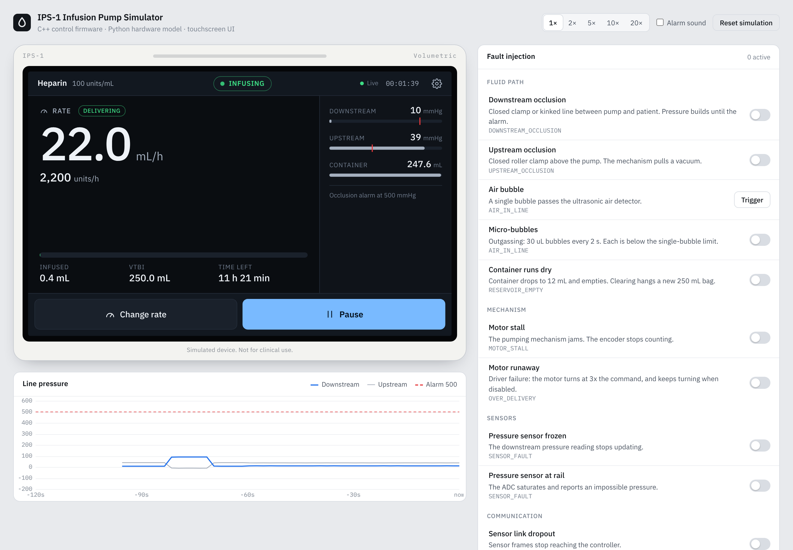
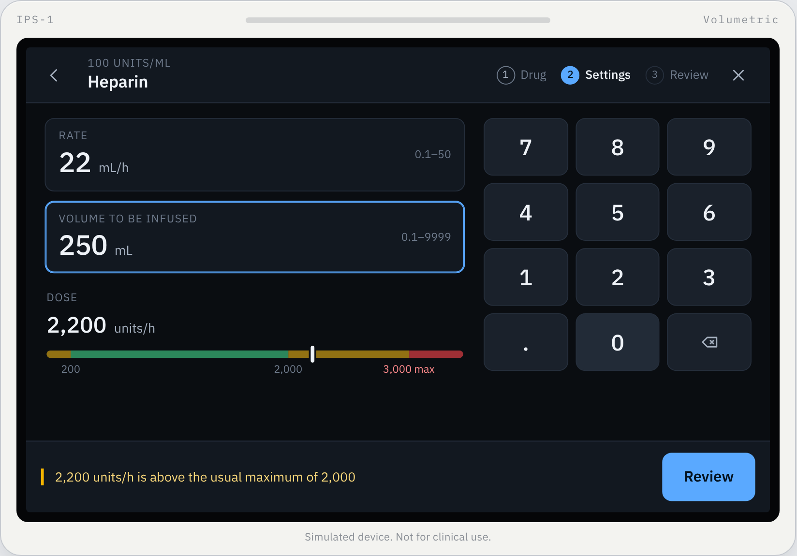
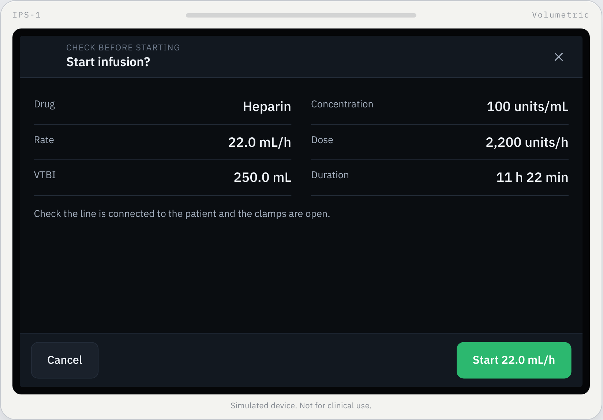
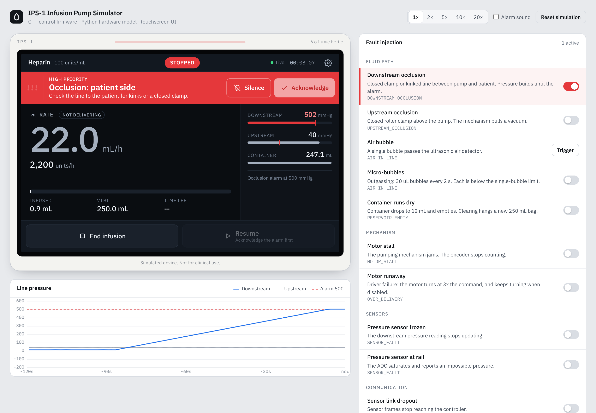

# IPS-1 Infusion Pump Simulator

[](https://github.com/hareemakram/infusion-pump-simulator/actions/workflows/ci.yml)

A volumetric infusion pump built the way regulated medical software is built. The **C++
control firmware** handles flow, dose limits and alarms. A **Python hardware simulator** plays
the pump mechanism and sensors and injects faults. A **React touchscreen** is the operator
interface. Everything is tested automatically, and the documentation follows **IEC 62304**,
**ISO 14971** and **IEC 62366**. A generated matrix links every requirement to its tests.



> **Educational portfolio project. Not a medical device and not certified; it follows IEC 62304 / ISO 14971 practices for demonstration only.** Drug library values are illustrative.

## What it does

| | |
|---|---|
| **Firmware (C++17)** | State machine (Idle, Ready, Priming, Infusing, Paused, KVO, Alarm, Fault). Rate control from encoder feedback. Drug library with soft and hard dose limits. Alarms for downstream and upstream occlusion, air in line (single bubble and cumulative), empty container, motor stall, over-delivery and runaway, implausible or frozen sensors, and lost sensor link. IEC 60601-1-8 alarm priorities with latching, acknowledge and silence |
| **Hardware simulator (Python)** | Hydraulic model of the line (compliance, resistance, cavitation), stepper mechanism and encoder, noisy sensors. Ten injectable faults. Closed loop at 100 ms, real time or up to 20x faster |
| **Touchscreen (React + TypeScript)** | Device-style 800 x 500 display. Drug-library programming on an on-screen keypad with a live dose and limit scale. Review screen, then a separate start confirmation. Alarm banner with priority shown by colour, word and symbol. Stale-data detection. Engineering bench beside it: fault switches, pressure trend, event log, and pump readings compared with the simulated truth |
| **Verification** | GoogleTest, pytest (unit and closed loop against the compiled firmware), Jest, Playwright. Coverage, ASan/UBSan, GCC and Clang builds. Traceability is checked in CI |

<table>
<tr>
<td></td>
<td></td>
</tr>
<tr>
<td align="center">Programming: the dose is checked against the drug library as you type</td>
<td align="center">A second, explicit confirmation before delivery starts</td>
</tr>
</table>



## Quick start

Requirements: a C++17 compiler, CMake 3.20+, Python 3.10+, Node 20+. GoogleTest is found on
the system or downloaded by CMake.

```bash
# 1. Firmware
cmake -S . -B build && cmake --build build

# 2. Touchscreen UI
cd ui && npm ci && npm run build && cd ..

# 3. Run: service + UI on http://127.0.0.1:8000
PYTHONPATH=simulator python3 -m pumpsim serve
```

On Windows PowerShell, use `$env:PYTHONPATH="simulator"; python -m pumpsim serve`.

**Demo script (2 minutes).** Choose *New infusion*, then Heparin, 22 mL/h, 250 mL. The dose is
above the soft limit, so tick the override, then *Prime line*. Set the speed to 10x so priming
is quick, then *Start* and confirm. Now turn on *Downstream occlusion* in the fault panel and
watch the pressure climb to the threshold. The pump stops with a high-priority alarm.
*Acknowledge* stays disabled until you turn the fault off. After acknowledging, the pump waits
paused. It never restarts by itself.

For UI development, run `npm run dev` in `ui/` (port 5173, proxied to the service on 8000).

### Headless

```bash
PYTHONPATH=simulator python3 -m pumpsim scenarios   # inject every fault, print detection times
PYTHONPATH=simulator python3 -m pumpsim faults      # list injectable faults
```

## Architecture

```
React touchscreen  --REST / Server-Sent Events-->  Python service (pumpsim)
                                                    ├─ plant model + fault injector
                                                    └─ HAL pipe: SENSOR / TICK / CMD
                                                         │
                                                         ▼
                                                    pump_firmware (C++)
                                                    PumpController, detectors,
                                                    alarm manager, drug library
```

The firmware never reads a clock or touches I/O itself. The HAL hands it one sensor frame
and one tick per 100 ms cycle. That makes it deterministic: unit tests run hours of infusion
in milliseconds, and the same code would sit behind a real sensor ISR. Details are in the
[architecture document](docs/03-software-architecture.md).

```
firmware/   C++ control software, GoogleTest suite
simulator/  Python hardware model, fault injection, HTTP service, pytest suite
ui/         React touchscreen, Jest and Playwright tests
docs/       IEC 62304 / ISO 14971 / IEC 62366 documentation and generated evidence
tools/      trace.py: requirement -> test -> result matrix
```

## Testing

```bash
make test        # everything below, then the traceability check
make test-cpp    # GoogleTest            (86 tests)
make test-py     # pytest                (62 tests, incl. closed-loop runs against the binary)
make test-ui     # Jest                  (57 tests)
make test-e2e    # Playwright            (desktop and touch viewport)
make coverage    # gcovr + pytest-cov
make trace       # fails if any requirement lacks a passing test
```

| Measured 2026-11-17 | |
|---|---|
| Automated test cases | 213 passing (86 C++, 62 Python, 57 Jest, 8 Playwright) |
| Requirements verified | 41 of 41 |
| Firmware line coverage | 98 % (gcovr) |
| Simulator coverage | 94 % (pytest-cov) |
| UI statement coverage (Jest) | 80 %, with the rest covered end-to-end |

### Fault detection (from the [fault response report](docs/generated/fault-response-report.md))

| Injected fault | Detected after |
|---|---|
| Downstream occlusion, 100 mL/h, medium sensitivity | 17.5 s |
| Downstream occlusion, 100 mL/h, high sensitivity | 10.4 s |
| Upstream occlusion | 14.1 s |
| Single 80 uL air bubble | 0.1 s |
| Motor stall / runaway | 0.8 s / 0.4 s |
| Frozen pressure sensor | 5.1 s |
| Sensor link dropout | 0.6 s |

## Regulatory documentation

| Document | |
|---|---|
| [Software development plan](docs/01-software-development-plan.md) | Lifecycle, Class C rationale, SOUP, known anomalies |
| [Software requirements specification](docs/02-software-requirements-specification.md) | 41 numbered requirements with risk links |
| [Architecture and design](docs/03-software-architecture.md) | Items and units, state machine, HAL protocol, plant model |
| [Risk management file](docs/04-risk-management-file.md) | ISO 14971 analysis of 18 hazards |
| [Usability engineering](docs/05-usability-engineering.md) | IEC 62366 use errors and the UI decisions they drove |
| [Traceability matrix](docs/generated/traceability-matrix.md) | Generated: requirement, tests, result |
| [Test report](docs/generated/test-report.md) | Generated: totals per suite |

Tests are linked to requirements in their own source (`// @req SRS-030`,
`@pytest.mark.req("SRS-030")`, or `(SRS-030)` in a test title), so the matrix cannot drift
from the code.

## Design decisions worth discussing

- **Volume comes from the encoder, not the command.** A jammed or slipping mechanism therefore
  cannot make the display claim delivery that did not happen. It also enables runaway detection.
- **No automatic restart.** After any high-priority alarm the pump goes to Paused, never to
  Infusing, even when the cause has cleared.
- **Implausible data is never used.** Out-of-range, frozen or time-reversed sensor frames put
  the pump in a Fault state that only a restart clears.
- **The UI mirrors the limit checks only for feedback.** The firmware re-validates every
  command, and the UI shows the firmware's verdict.
- **Known residual risk.** Relieving an occlusion releases about 0.5 mL of stored bolus. This
  is documented as KA-1 with a planned pressure back-off.

## License

MIT. See [LICENSE](LICENSE).
