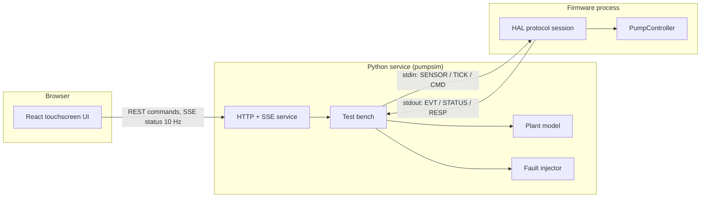
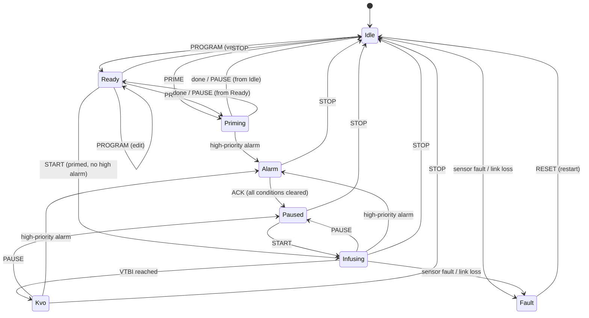

# Software Architecture and Design

| | |
|---|---|
| Document | IPS-SAD-003 |
| Standard | IEC 62304 clauses 5.3 and 5.4 |

## 1. Context



The firmware runs as a separate process and only talks through its HAL. On a real device
the same `PumpController` would be called from the sensor ISR and the control timer. In the
simulator, the Python test bench sends the same calls over a text pipe. Because nothing in
the controller depends on the simulator, the code under test is the code that would ship.

## 2. Software items and units

### 2.1 Firmware (`firmware/`)

| Unit | File | Responsibility | Requirements |
|---|---|---|---|
| Types | `types.hpp/.cpp` | States, alarm IDs, priorities, sensor frame | SRS-040 |
| Configuration | `config.hpp` | All safety constants, each traced to a requirement | all |
| DrugLibrary | `drug_library.hpp/.cpp` | Dose computation and soft/hard limit checks | SRS-001..007 |
| AlarmManager | `alarm_manager.hpp/.cpp` | Condition vs. latch, acknowledge, silence, priority order | SRS-040..043 |
| Detectors | `detectors.hpp/.cpp` | Debouncer, occlusion, air in line, flow monitor, sensor plausibility | SRS-030..037, 050, 051, 054 |
| EventLog | `event_log.hpp/.cpp` | Bounded audit trail | SRS-060 |
| PumpController | `pump_controller.hpp/.cpp` | State machine, delivery accounting, alarm response, watchdog | SRS-010..023, 035, 038, 052, 053 |
| Protocol | `protocol.hpp/.cpp` | Parses HAL lines and formats responses | SRS-070 |
| `pump_firmware` | `app/main.cpp` | Process entry point | - |

### 2.2 Touchscreen UI (`ui/src/`)

| Unit | Responsibility |
|---|---|
| `api/` | Typed REST client and data types |
| `hooks/usePump` | Snapshot load, SSE stream merge, stale-data watchdog (SRS-082) |
| `domain/dose` | Mirror of the firmware limit check, so the operator gets feedback while typing. The firmware's answer is the one that counts |
| `domain/actions` | Which controls each pump state offers. Only actions the firmware accepts are shown |
| `domain/alarms` | Alarm wording and priority ordering |
| `domain/keypad` | Keypad reducer that refuses malformed numbers |
| `components/` | Device frame, status bar, alarm banner, program wizard, confirmation sheets, test-bench panels |

### 2.3 Simulator (`simulator/pumpsim/`)

| Unit | Responsibility |
|---|---|
| `plant.py` | Lumped hydraulic model: container, upstream segment, peristaltic mechanism, compliant downstream line, cannula resistance. Sensor noise and quantisation |
| `faults.py` | Ten injectable faults: occlusions, air, empty container, motor stall/runaway, frozen or railed sensor, link dropout |
| `firmware.py` | Starts `pump_firmware` and speaks the HAL protocol |
| `bench.py` | Closes the loop at 100 ms and records history and events |
| `service.py` | HTTP and Server-Sent Events API for the UI. Standard library only |
| `scenarios.py` | Scripted fault scenarios that produce the fault response report |

## 3. Pump state machine



Every state can go to `Fault`. Only the most relevant arrows are drawn. `Alarm` never leads
directly to a delivering state (SRS-013).

## 4. Detailed design notes

### 4.1 Control cycle

Each 100 ms cycle runs in a fixed order:

1. The HAL delivers a `SensorFrame`. `on_sensor_frame()` checks plausibility first. An
   implausible frame raises `SENSOR_FAULT` and is discarded. A plausible frame updates the
   encoder delta and evaluates the occlusion, air and container detectors.
2. `tick(now)` integrates the commanded steps for the cycle that just ended and compares them
   with the encoder (stall, over-delivery). It then checks the watchdog, advances priming and
   VTBI, and applies the alarm response: a system fault goes to `Fault`, a high alarm goes to `Alarm`.
3. `tick()` returns the motor command for the next cycle.

Any state transition recomputes the motor command at once, so `pause()` returns with the motor
already disabled (SRS-012).

### 4.2 Alarm model

Each alarm has two flags: `condition` (present now) and `latched` (displayed until acknowledged).
High and medium alarms latch. Acknowledge only clears latches whose condition has gone (SRS-043).
While the pump is in `Alarm`, the occlusion and container conditions are still evaluated, so a
persistent occlusion cannot be acknowledged away.

### 4.3 Flow monitoring

The commanded steps and the encoder steps are summed over a 60 s sliding window. Over-delivery
is `delivered - commanded > max(20 steps, 10 %)`. The 20-step floor (0.01 mL) makes runaway
detectable even at 1 mL/h, where a percentage alone would take minutes. The window is reset
whenever the motor switches between running and stopped, so stopping never leaves a stale baseline.

### 4.4 Segregation

The UI and the Python service hold no safety logic of their own. The UI mirrors the dose check
only for feedback. The firmware validates every command again, and the UI shows the firmware's
verdict. The firmware process is isolated by the OS process boundary, so a UI or service crash
cannot corrupt controller state. A lost sensor stream trips the firmware watchdog.

## 5. HAL protocol

Line-oriented ASCII on stdin/stdout. One message per line, `key=value` fields. Fields named
`msg`, `reason` or `name` run to the end of the line.

| Direction | Line | Meaning |
|---|---|---|
| in | `SENSOR t=<ms> pd=<mmHg> pu=<mmHg> air=<uL> res=<mL> enc=<steps>` | One sensor frame. No reply |
| in | `TICK t=<ms>` | Run the controller. Reply: queued `EVT` lines, then one `STATUS` |
| in | `CMD <NAME> [k=v ...]` | Operator command: `PROGRAM drug rate vtbi [weight] [confirm]`, `PRIME`, `START`, `PAUSE`, `STOP`, `TITRATE rate [confirm]`, `ACK`, `SILENCE`, `SENS level`, `RESET`, `LIBRARY`, `STATUS` |
| out | `HELLO firmware=1.0.0 protocol=1` | Sent once at start |
| out | `EVT seq= t= kind= msg=...` | Event log entry |
| out | `STATUS t= state= primed= motor= sps= ... alarms=ID:P:C:T,...` | Full status snapshot |
| out | `RESP cmd= ok= [reason=...]` | Result of a command |
| out | `DRUG ... name=...`, `LIBVER version=` | Drug library listing |
| out | `ERR msg=...` | Malformed input. State unchanged |

`reason` starts with `CONFIRM_REQUIRED:` when a soft limit needs operator confirmation.

## 6. Plant model

```
container --R_up--> [upstream, C_up] --pump--> [downstream, C] --R--> patient (venous 8 mmHg)
```

| Parameter | Value | Effect |
|---|---|---|
| Downstream compliance C | 0.001 mL/mmHg | Occlusion pressure rises at rate / C. At 100 mL/h that is about 28 mmHg/s |
| Downstream resistance R | 500 mmHg s/mL | About 22 mmHg at 100 mL/h, 147 mmHg at 999 mL/h |
| Upstream head / resistance | 40 mmHg / 300 mmHg s/mL | Container about 55 cm above the pump |
| Cavitation | -300 mmHg | Below this the mechanism moves gas, not fluid |
| Mechanism | 2000 steps/mL | Same constant as the firmware |
| Noise | 0.6 mmHg, rounded to 0.1 | Seeded, so runs are reproducible |

Euler integration at 100 ms is stable here (dt / RC = 0.2). The model also tracks ground
truth (true flow, outflow to the patient, air to the patient), which the UI shows next to the
pump's own readings.
